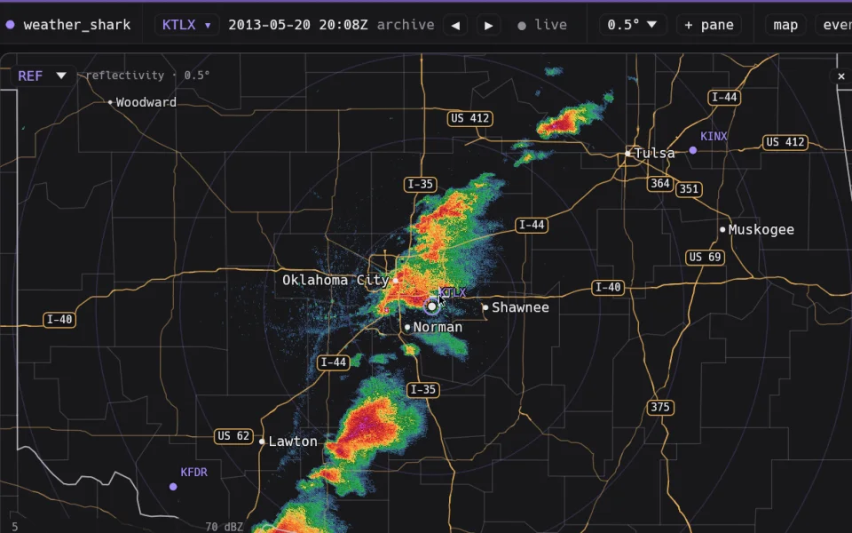
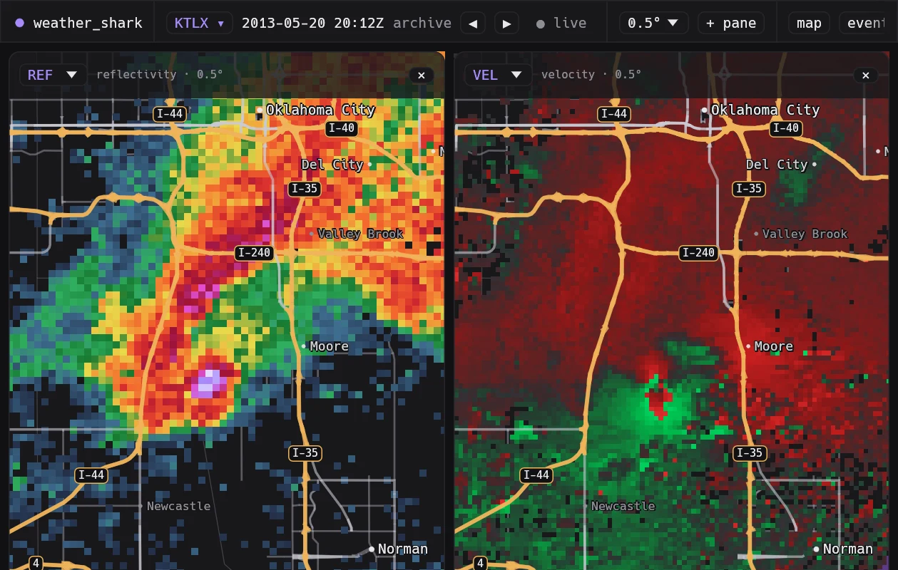
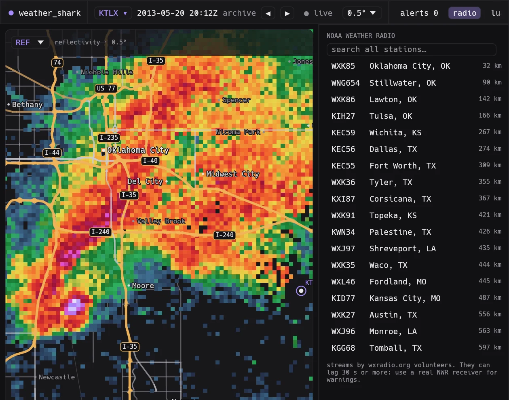

# weather_shark

A dark, minimal radar viewer for tracking tornadoes, written in Rust with egui.
It reads raw NEXRAD Level II data and shows products side by side in synced
panes (same view, same crosshair), so a velocity couplet lines up with the
hook echo and any debris signature in CC.

Everything that's a matter of taste lives in a Lua file: colours, colour
tables, panes, alert rules and sounds.

**[Live demo](https://tuke.gg/demos/weather_shark/)** (the same code compiled to WebAssembly)





<sub>The 2013 Moore tornado at 20:12 UTC: the debris ball in reflectivity (left) sits right on the velocity couplet (right).</sub>

## Why

i got tired of paying subscriptions

## Features

- Real data from NOAA's public NEXRAD archive on AWS (live, or any past scan back to the 2000s)
- Products: reflectivity, velocity, correlation coefficient, ZDR, spectrum width, PHI
- Starts with one pane; each pane you add splits the last one in a fibonacci spiral (like dwm/trwm),
  up to 6. Every pane shares pan/zoom and a crosshair that reads out the value under it
- A chase map: roads down to street level, interstate and US highway numbers, and town names from
  OpenStreetMap, plus state and county lines. Every layer can be toggled
- Click any radar site on the map to switch to it, or search by name
- Live NWS warnings drawn as their storm polygons; watches drawn as the counties they cover.
  You pick which kinds show up, and each can play its own sound (the TV / radio Emergency Alert
  System tone for tornadoes by default). A "simulate" button previews your warning colours and sounds
- SPC convective outlooks for days 1–3: categorical risk (MRGL … HIGH) or the tornado, wind and
  hail probabilities, with the significant (hatched) area dashed. Outline only, filled, or any
  colour per risk level, all set in Lua. Watches and warnings each have their own switch
- NOAA Weather Radio: live streams from the transmitters nearest your radar
- Bookmarks for past events (Moore, El Reno, Joplin, Mayfield, Rolling Fork)
- Open your own Level II files: drop one on the window, pass it on the command line, or use
  "open file…" in the events menu
- Almost everything is in the Lua config: which toolbar buttons exist (and their order), key
  bindings, every map layer, alert types and sounds, colours. It hot-reloads on save, and the
  in-app editor has syntax colouring with colour swatches
- Runs on Linux, macOS, Windows and in the browser
- Scans are decoded while they download: the lowest tilt shows up after roughly a fifth of the
  file, with a progress bar for the rest, and recent scans are cached so stepping through them is instant

## Install

Download a build for Linux, macOS (Apple Silicon or Intel) or Windows from the
[releases page](https://github.com/TukeCS/weather_shark/releases). They aren't code-signed, so the
first launch warns you: on Windows click "More info" → "Run anyway"; on macOS run
`xattr -d com.apple.quarantine weather_shark` once (or right-click → Open).

Or build it yourself:

```sh
cargo install --git https://github.com/TukeCS/weather_shark
```

## Running

```sh
weather_shark                                # live, starting at the site in your config
weather_shark KTLX "2013-05-20 20:08"        # a past scan (UTC)
weather_shark ~/Downloads/KTLX20130520_201229_V06   # a Level II file you have
```

You can also drop a radar file onto the window.

On Linux, sound goes through PulseAudio/PipeWire when it's running (falling back to ALSA), and
building needs the `libasound` headers. To check your speakers:

```sh
weather_shark test-sound eas        # or wea, siren, alarm, beep, chime
weather_shark test-sound radio      # 15 s of the Oklahoma City NOAA Weather Radio stream
```

The README screenshots are made by the app itself:

```sh
weather_shark screenshot out.png KTLX "2013-05-20 20:13" --panes REF,VEL --layout columns --view 14 --at 35.21,-97.54
```

### Keys

These are the defaults; every one can be changed or turned off in `keys = { ... }`.

| key | |
|---|---|
| drag / scroll | pan / zoom (double-click zooms in) |
| ← → | previous / next scan |
| ↑ ↓ | tilt |
| N | add a pane |
| X | close the pane under the mouse |
| M / C / W | toggle roads / city names / warnings |
| L | follow live |
| R | recentre on the radar (zoom from `view_km`) |
| O | open a radar file |
| Space | play / stop the nearest NOAA Weather Radio stream |
| , | open the config editor |

## Config

The config is written on first run to:

- Linux: `~/.config/weather_shark/config.lua`
- macOS: `~/Library/Application Support/weather_shark/config.lua` (or `~/.config/weather_shark/` if you have it)
- Windows: `%APPDATA%\weather_shark\config.lua`

`weather_shark --help` prints the exact path, `weather_shark default-config` prints a fresh copy and
`weather_shark check` validates yours without opening a window. It reloads when you save it.

The script returns a table. Anything you leave out falls back to the default, so a config can be
as small as:

```lua
return {
    site  = "KINX",
    panes = { "REF", "VEL" },
    theme = { accent = "#ff6b6b" },
}
```

Only the alert types that have a rule are fetched and shown, so the rules are also your filter:
leave out the watches to only see warnings, or add a `Flash Flood Warning` rule to see those.
Rules are checked in order and the first match wins. `map = false` or `list = false` hides a type
from the map or the list, and `sounds = false` silences everything:

```lua
alerts = {
    radius_km = 300,
    rules = {
        { event = "Tornado Warning", damage = "catastrophic", sound = "eas",   repeats = 3 },
        { event = "Tornado Warning", tornado = "observed",    sound = "eas",   repeats = 2 },
        { event = "Tornado Warning",                          sound = "eas"   },
        { event = "Severe Thunderstorm Warning", hail = 2.0,  sound = "beep"  },
        { event = "Severe Thunderstorm Warning",              file  = "storm.wav" },
    },
},
```

Layout, map layers, the toolbar and keys:

```lua
panes  = { "REF" },                         -- what opens on start
layout = { mode = "spiral", ratio = 0.5 },  -- spiral, dwindle, columns, grid
map    = { roads = true, cities = true, road_labels = true, counties = false },
radio  = { enabled = false },               -- removes the radio completely
ui     = { toolbar = { "site", "time", "alerts" }, legend = false },
keys   = { add_pane = "F2", radio = false },
```

Built-in sounds are `eas` (the TV / radio Emergency Alert System tone: 853 + 960 Hz for 8 s),
`wea` (the same tones in the phone alert rhythm: a 2 s tone and two 1 s tones, twice), `siren`,
`alarm` (2 s of the EAS tone), `beep` and `chime`. `file` plays a
.wav file next to the config (native only). The global `platform` is `"native"` or `"web"` if you
want the two to differ. See [`assets/default_config.lua`](assets/default_config.lua) for every option.

## NOAA Weather Radio

The `radio` panel lists live NOAA Weather Radio streams sorted by distance from the radar you're
viewing. Click one to listen. The streams are run by volunteers at [wxradio.org](https://wxradio.org)
and matched to transmitter locations from the NWS station list. Their terms allow direct listening
but not relaying, and they block clients that open several streams at once. So weather_shark only
ever plays one stream, straight from their server.



Streams can lag 30 seconds or more, so don't rely on them for warnings: use a real NWR receiver.

## Web build

```sh
rustup target add wasm32-unknown-unknown
cargo install wasm-bindgen-cli --version 0.2.130   # match Cargo.lock
./web/build.sh [output dir]                         # defaults to ../portfolio/demos/weather_shark
```

On the web, the config is edited in the app (the `lua` button) and kept in browser storage.
Opening the page with `#KTLX 2013-05-20 20:08` in the URL starts on that scan.

## How it works

- `level2.rs`: Archive II decoder. It reads the volume header, unpacks the bzip2 LDM records and parses message 31 radials into sweeps. It works incrementally, so finished sweeps (lowest tilt first) are shown while the rest of the file streams in.
- `render.rs`: rasterizes a sweep to a texture once, using an azimuth lookup table and a colour lookup per raw byte. Pan and zoom are then just GPU work.
- `config.rs`: runs the Lua in [piccolo](https://github.com/kyren/piccolo), a Lua VM written in pure Rust. That's what lets the config work in WebAssembly too.
- `alerts.rs`, `sound.rs`: NWS alert matching. Sounds are synthesized in Rust and played with rodio on native and Web Audio in the browser.
- `mvt.rs`, `tiles.rs`: a small vector-tile decoder and tile cache for roads and places. While sharper tiles load, already-loaded parent tiles fill in.
- `app/layout.rs`: pane tiling (spiral, dwindle, columns, grid). Panes animate between layouts.
- `radio.rs`: wxradio.org stream list plus playback, with rodio on native and an `<audio>` element on the web.
- `assets/`: state and county outlines (US Census 2010, 1:20m) packed as delta-encoded polylines with FIPS codes (`tools/geo.py`), the WSR-88D site list and the NWR transmitter list.

Map data © [OpenStreetMap](https://www.openstreetmap.org/copyright) contributors, served by [OpenFreeMap](https://openfreemap.org).
